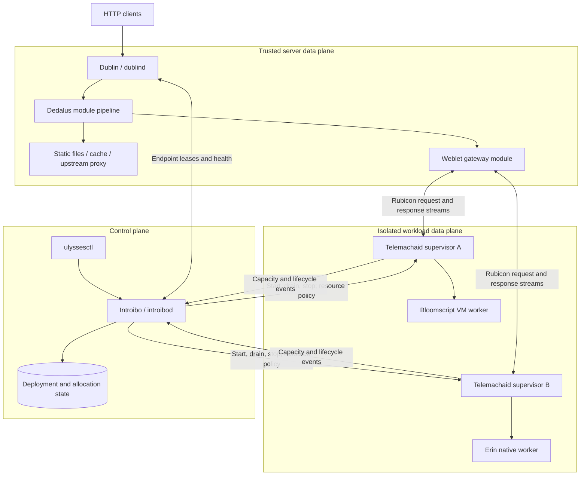
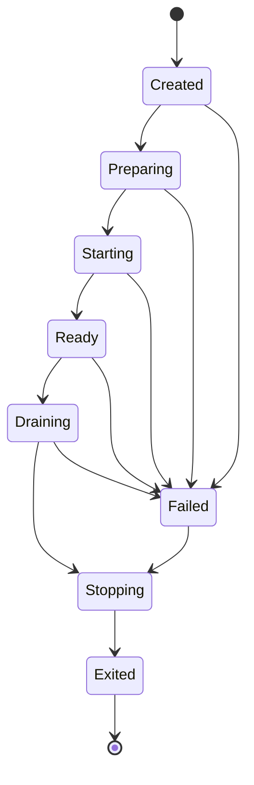
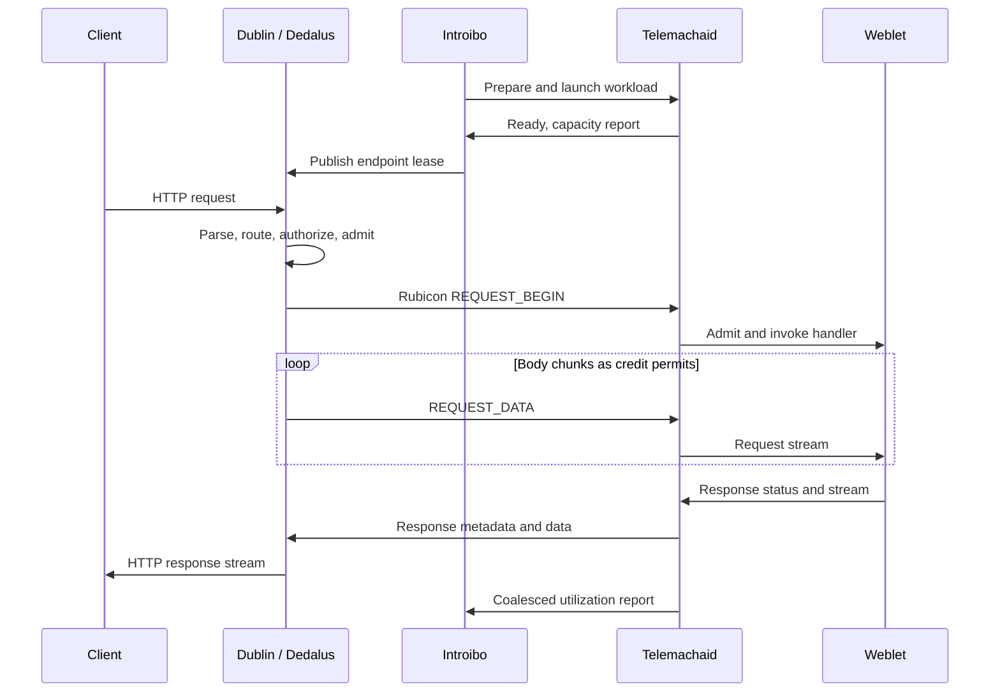

# Ulysses: A Programmable Webserver

> A webserver with the salty breeze of Erin and the blowing winds of the Aegean.

Ulysses is a **programmable webserver and application-execution platform**. It combines a modular HTTP server, a native extension ABI, a domain-specific web programming language, a native application framework, an isolated execution environment, and a workload scheduler into a single toolchain for developing, deploying, and operating websites, web applications, APIs, reverse proxies, gateways, and other network-oriented software.

Unlike a conventional webserver, whose configurability is primarily expressed through a configuration file and a collection of extensions, Ulysses treats programmability as a first-class architectural concern. A developer can configure a traditional static website, implement an HTTP middleware module, write a sandboxed web application in Bloomscript, or compile a high-performance native application using Erin. All of these approaches coexist within one deployment, sharing a common HTTP model, routing infrastructure, observability facilities, and security policy.

The individual subsystems are deliberately separated. The HTTP server does not execute arbitrary application code inside its address space; the application runtime does not implement a second HTTP server; the workload scheduler does not carry application request bodies; and the module ABI does not become an unrestricted interface into server internals.

**Status:** This README describes the proposed architecture and implementation contract. Features, commands, APIs, configuration files, and language examples are design targets, not claims that they are already implemented. Example syntaxes are provisional.

## Table of contents

- [Design principles](#design-principles)
- [The Ulysses toolchain](#the-ulysses-toolchain)
- [System architecture](#system-architecture)
- [Dublin: the HTTP server](#dublin-the-http-server)
- [Dedalus: the server module ABI](#dedalus-the-server-module-abi)
- [Weblets: the application model](#weblets-the-application-model)
- [Bloomscript: virtual Weblets](#bloomscript-virtual-weblets)
- [Erin: native Weblets](#erin-native-weblets)
- [Telemachaid: isolation and execution](#telemachaid-isolation-and-execution)
- [Rubicon: interprocess communication](#rubicon-interprocess-communication)
- [Introibo: workload scheduling](#introibo-workload-scheduling)
- [Routing and the request lifecycle](#routing-and-the-request-lifecycle)
- [Configuration and deployment](#configuration-and-deployment)
- [Building, packaging, and distribution](#building-packaging-and-distribution)
- [Security model](#security-model)
- [State, storage, and distributed operation](#state-storage-and-distributed-operation)
- [Observability and operations](#observability-and-operations)
- [Tooling and repository layout](#tooling-and-repository-layout)
- [Implementation roadmap](#implementation-roadmap)

## Design principles

1. **A small, protocol-correct server core.** Dublin owns connections, protocol state, request lifetimes, resource accounting, and the invocation of modules. Features that do not require core privileges live in Dedalus modules or Weblets.
2. **Applications are not server extensions.** Dedalus modules extend Dublin itself and are ordinarily trusted. Weblets implement application logic and execute across an isolation boundary, irrespective of their source language.
3. **Separate the control plane from the data plane.** Introibo controls workload placement and lifecycle. Dublin handles live HTTP traffic. Rubicon supplies the communication primitives connecting them to Telemachaid.
4. **One application contract, multiple execution engines.** Bloomscript and Erin expose equivalent request, response, cancellation, streaming, capability, and lifecycle semantics, without requiring identical implementations.
5. **Explicit capabilities rather than ambient authority.** Applications do not receive unrestricted filesystem, network, process, environment, or credential access simply because their host has it.
6. **Asynchrony and backpressure by construction.** Network I/O, streaming, bounded queues, cancellation, and deadlines are part of the platform contract rather than optional conventions.
7. **Reproducible deployments.** Artifacts are immutable, versioned, validated, and activated transactionally. Configuration and application changes should not require recompiling Dublin.
8. **Modular adoption.** Dublin can serve static files or proxy requests without running Introibo or installing a Bloomscript compiler. Additional runtime facilities are enabled only when required.
9. **Native performance without native trust.** An Erin Weblet can use native machine code, but native execution does not grant it access to Dublin's address space or exempt it from sandbox policy.
10. **Compatibility through contracts.** ABI versions, wire protocol versions, runtime versions, and artifact formats evolve independently and have explicit negotiation and compatibility rules.

## The Ulysses toolchain

| Subsystem | Responsibility | Principal interface |
|---|---|---|
| **Dublin** | HTTP transport, connection management, server core, module pipeline | `dublind`, internal server interfaces |
| **Dedalus** | Extending Dublin with trusted server-side modules | Versioned C ABI, `libdedalus`, language bindings |
| **Bloomscript** | Language, compiler, runtime semantics, and standard library for virtual Weblets | `.bloom`, `.weblbin`, `bloomc` |
| **Erin** | Native Weblet framework for On1x, C, and other supported languages | `liberin`, native SDK and bindings |
| **Telemachaid** | Per-workload execution environment, isolation, supervision, and resource enforcement | Host supervisor, VM runner, guest bootstrap APIs |
| **Rubicon** | Versioned IPC, request streaming, control messages, and telemetry transport | `librubicon`, wire protocol |
| **Introibo** | Desired-state reconciliation, workload placement, instance lifecycle, and capacity management | `introibod`, scheduler control API |

These are logical components, not seven permanent background services. The two primary persistent daemons are `dublind` and `introibod`. Telemachaid supervisors and Weblet workers are workload processes managed by Introibo, not separately administered system daemons. Compilers, development utilities, and administrative tools run on demand.

When Dublin is deployed without Weblets, `introibod` and Telemachaid are unnecessary. Similarly, a Bloomscript compiler need not be present on a production server that consumes prebuilt, verified artifacts.

## System architecture



The data plane consists of Dublin, the Dedalus request pipeline, and the application request/response streams flowing to isolated workers. The control plane consists of configuration activation, workload registration, scheduling, health reporting, endpoint discovery, and lifecycle management.

Introibo is **not** an HTTP reverse proxy and is never a mandatory per-request RPC hop. A Dublin worker uses a locally available, versioned snapshot of eligible Weblet endpoints. It selects a healthy endpoint and communicates with it through Rubicon. Introibo updates that snapshot as deployments or worker availability change.

There are two levels of scheduling:

- **Workload scheduling:** Introibo decides where and how many Telemachaid instances run, subject to resource budgets, placement policies, and health.
- **Request dispatch and admission:** Dublin selects one of the eligible instances for a particular request, subject to its advertised capacity, route policy, and local bounded queues. A Telemachaid runtime enforces its own concurrency limit and can reject excess work.

Operating-system thread and process scheduling remains the responsibility of the operating system. A Bloomscript VM may also schedule its own fibers or tasks; that is language-runtime scheduling, not Introibo's responsibility.

## Dublin: the HTTP server

Dublin is the network-facing core of Ulysses. It owns the sockets exposed to clients and turns protocol-specific exchanges into a common internal HTTP request/response model. It is intended to be usable as a standalone webserver, with little more than a conventional configuration file and a few standard Dedalus modules.

### Protocol and transport core

Dublin's core provides:

- HTTP/1.1 parsing, framing, persistent connections, connection shutdown, and upgrade handling.
- HTTP/2 framing, stream multiplexing, HPACK integration, stream and connection flow control, and graceful shutdown.
- HTTP/3 over QUIC, including QPACK integration, stream management, transport backpressure, and connection lifecycle management.
- TCP and UDP listener management, asynchronous I/O, connection limits, timeouts, request size limits, and overload handling.
- A pluggable event-loop abstraction, initially targeting Linux with a suitable polling backend; other operating systems can have their own transport implementations.
- TLS session integration, ALPN, certificate selection, and consistent enforcement of transport security policies.
- Normalization of request metadata into a representation independent of the incoming HTTP version, while retaining protocol-specific information when required.

Dublin should use reviewed TLS and QUIC implementations behind narrow provider interfaces. TLS record processing and QUIC cryptography should not be reimplemented as ordinary middleware. The core owns transport state; a certificate-management module may obtain, renew, and select credentials, and a provider may implement the underlying cryptographic transport. HTTP/3 requires the QUIC-integrated TLS handshake, not a separate optional HTTPS filter.

WebSocket, server-sent events (SSE), HTTP CONNECT, gRPC, and bidirectional streaming are supported through suitable protocol facilities and explicit route or module policies. Not all features have identical wire representations across HTTP versions. Dublin must expose a consistent application API while respecting those differences.

### Standard Dedalus modules

| Proposed module | Function |
|---|---|
| `dedalus-router` | Virtual hosts, method/host/path/header matching, rewrites, redirects, named routes |
| `dedalus-static` | Static files, directory indexes, byte ranges, conditional requests, safe path resolution |
| `dedalus-reverse-proxy` | Upstream connection pools, streaming, header policy, health checks, explicit retry rules |
| `dedalus-forward-proxy` | Authenticated, restricted forward proxy and controlled CONNECT tunneling; disabled by default |
| `dedalus-balancer` | Upstream selection, weighted round-robin, least outstanding requests, rendezvous hashing |
| `dedalus-weblet` | Application gateway: converts Dublin exchanges to Rubicon Weblet streams |
| `dedalus-fastcgi` | Optional interoperability with external FastCGI application servers |
| `dedalus-gateway` | API routing, request validation, quota policies, and upstream transformation |
| `dedalus-auth` | Authentication policy and verified identity propagation |
| `dedalus-authz` | Authorization, route access policy, role and claim checks |
| `dedalus-ratelimit` | Token buckets, concurrent request budgets, tenant quotas |
| `dedalus-cache` | HTTP-aware response caching, revalidation, invalidation hooks, cache-key policies |
| `dedalus-compress` | Content negotiation and streaming response compression |
| `dedalus-cors` | Explicit cross-origin policy and preflight handling |
| `dedalus-headers` | Header normalization, insertion, removal, and security headers |
| `dedalus-certs` | Certificate loading, rotation, and optional automated certificate provisioning |
| `dedalus-websocket` | WebSocket gateway and upgrade/extended CONNECT integration where supported |
| `dedalus-observe` | Structured access logs, metrics, tracing, and audit hooks |
| `dedalus-errors` | Configurable error responses and error-page dispatch |
| `dedalus-health` | Restricted readiness and liveness endpoints |

Some modules depend on core protocol hooks, and some depend on one another. They declare those dependencies rather than relying on an undocumented initialization order. The distribution can statically compile essential modules or dynamically load approved modules through the same ABI.

A conventional Dublin installation should be able to function as a general-purpose webserver, reverse proxy, static file server, load balancer, TLS terminator, API gateway, and application gateway. A Weblet is necessary only when application-specific behavior is desired.

## Dedalus: the server module ABI

Dedalus is Ulysses' stable, versioned C ABI for implementing extensions to Dublin. Its purpose is to make the server extensible without exposing unstable C++ classes, private allocator structures, or internal connection state. Modules may be implemented in C, C++, On1x, Rust, or any language capable of interoperating with the published C ABI.

Dedalus is not a general-purpose third-party application sandbox. In-process native modules operate within Dublin's trust boundary and must be treated as privileged server code. Untrusted extensions should instead be implemented as isolated Weblets or out-of-process services accessed through a trusted gateway module.

### Module contract

A module descriptor declares its ABI major/minor versions, module identity, configuration schema, dependency list, supported hooks, thread-safety properties, and required host facilities. Dublin validates the descriptor before activation.

Illustrative C ABI shape (not a finalized header):

```c
#include <dedalus/dedalus.h>

static dedalus_result on_request(dedalus_exchange *exchange,
                                 void *module_state);

static const dedalus_module_v1 module = {
    .struct_size = sizeof(dedalus_module_v1),
    .abi_major   = 1,
    .abi_minor   = 0,
    .name        = "example.headers",
    .on_request  = on_request
};

DEDALUS_EXPORT const dedalus_module_v1 *dedalus_module_entry_v1(void)
{
    return &module;
}
```

The host ABI should provide explicit allocator and ownership contracts, opaque handles, length-delimited strings, asynchronous continuation handles, error codes, and context-bound access to request and response data. No exception may cross the ABI boundary, and no borrowed buffer may be retained beyond its documented lifetime.

Module lifecycle hooks include configuration validation, preparation, initialization, generation activation, worker initialization, request processing, response processing, drain, and shutdown. A module can register cleanup callbacks associated with individual exchanges. Modules that perform blocking I/O must use an approved bounded offload facility instead of blocking the connection event loop.

### Request pipeline

The exact hook sequence is defined by Dublin, not arbitrarily by plugin order:

1. Transport parsing and HTTP normalization.
2. Early rejection, request limits, host validation, and trusted proxy metadata normalization.
3. Request rewriting and route resolution (bounded rerouting when permitted).
4. Authentication, authorization, and rate/admission policies.
5. Request middleware and cache lookup under the applicable identity and cache policy.
6. Terminal handler: static files, proxy, isolated Weblet gateway, or another approved content handler.
7. Response transformation, appropriate cache storage, logging, metrics, and cleanup.

Modules declare which phases they participate in. Each handler returns a well-defined result such as continue, respond, suspend, decline (where allowed), or fail. Suspended operations resume through a single-use continuation, and the host handles cancellation, timeouts, and teardown. A response has a single logical owner, and after its headers have been committed, modules may not replace its status or framing.

Module ordering is validated against a dependency graph and security invariants. For example, a protected response may not be cached and served to another user without an explicitly correct cache key and authorization policy.

### Configuration replacement and ABI evolution

Dublin stages and validates a new module/configuration generation before activation. In-flight exchanges retain references to the old generation until completion or a drain deadline. Libraries cannot be unloaded while objects, callbacks, worker threads, or continuations originating from them remain live. Where unloading cannot be proven safe, a rolling process replacement is preferable to unsafe `dlclose` behavior.

Dedalus supplies the trusted **Weblet gateway module** (`dedalus-weblet`). The gateway speaks Rubicon to the Telemachaid host endpoint and consumes endpoint snapshots from Introibo. Dedalus defines how the gateway participates in Dublin; Rubicon defines the interprocess application and control protocols. Erin and Bloomscript Weblets do not directly import the Dublin module ABI.

## Weblets: the application model

A **Weblet** is an independently deployable application unit that provides one or more HTTP handlers and associated lifecycle logic. The same Weblet abstraction applies to a small form handler, an API endpoint, a complete website, a long-lived streaming service, or a larger application divided into multiple handlers.

There are two classes of Weblets:

| Property | Virtual Weblet | Native Weblet |
|---|---|---|
| Authoring environment | Bloomscript | Erin SDK: On1x, C, and supported bindings |
| Execution | Managed VM, optionally with approved JIT/AOT execution | Target-specific native process |
| Distribution | Versioned `.weblbin` package | Native executable and manifest, optionally bundled |
| Host boundary | Telemachaid | Telemachaid |
| Application protocol | Rubicon Weblet protocol | Rubicon Weblet protocol |
| Capabilities and quotas | Host-enforced | Host-enforced |
| Failure isolation | Worker/process boundary | Worker/process boundary |

A Weblet is **not** necessarily one container, one process, one file, or one HTTP route. A Weblet deployment can have multiple versions and replicas; each replica is an independently managed Telemachaid workload instance, usually backed by one or more guest worker processes. The deployment specifies the intended entry points and concurrency limits.

### Application interface

Both Weblet classes expose equivalent operations for initialization, readiness, request handling, cancellation, optional background work, draining, and graceful shutdown. Each incoming request receives a context with:

- HTTP method, host, normalized path, query parameters, ordered headers, cookies, route parameters, and an asynchronous body reader.
- Verified caller identity and claims, if an authentication module has populated them; never credentials inferred from arbitrary incoming identity headers.
- An absolute or remaining deadline derived from trusted host policy, a cancellation signal, a request identifier, a trace context, and approved capability handles.
- A response writer supporting headers, status, bounded streaming, optional trailers, and cancellation-aware completion.

The request body is a stream, not necessarily a complete string in memory. Helpers may read JSON, forms, or multipart uploads, but they must enforce configured limits. Application code may emit a complete response for convenience or incrementally write response chunks.

Long-lived connections and background work consume explicit capacity. Background jobs are not silently detached when the HTTP request completes; they require a managed task scope, deployment permission, and a separately defined lifetime. For durable work, the application uses an external or explicitly provisioned queue.

## Bloomscript: virtual Weblets

Bloomscript is Ulysses' web-oriented programming language for Virtual Weblets. It is intended to combine a pleasant high-level programming model with domain-specific syntax for the things web applications manipulate constantly: HTTP exchanges, document trees, selectors, URIs, routes, templates, asynchronous tasks, and IPC.

Bloomscript is a general-purpose application language within the permissions of its runtime. It is not just a templating syntax embedded inside HTML, nor a configuration language for Dublin. A Bloomscript program is compiled, validated, and deployed as a Weblet.

### Language design

The proposed language includes lexical scoping; closures and first-class functions; records, tuples, lists, maps, enums and tagged unions; pattern matching and destructuring; modules and explicit imports/exports; structured exceptions or result types; asynchronous functions, tasks, cancellation, and channels; iteration, generators and stream combinators; and a gradual emphasis on statically checkable types, with an explicit dynamic `Value` type at data boundaries.

For an initial implementation, use an explicitly typed core with local type inference, algebraic data types, and checked conversions from untyped JSON/DOM values. This avoids prematurely committing to the complexity of a full gradual type system. A compatible dynamic layer can be added later.

### First-class web literals

| Literal | Illustrative syntax | Meaning |
|---|---|---|
| Node | `node<section class="card">{title}</section>` | Structured document node, with context-aware interpolation |
| Selector | `css"article > h2"` | Compiled CSS selector |
| XPath | `xpath"//article/title"` | Parsed XPath expression with explicit evaluation context |
| URI | `uri"https://example.org/api"` | Structured, validated URI value |
| Router | `route"GET /articles/:id"` | Typed route pattern, method and parameters |
| IPC | `ipc"service:inventory"` | Logical destination resolved through an authorized Rubicon capability |
| Template | `template"<p>{message}</p>"` | Compiled template with an appropriate escaping policy |

Literals construct structured values. A URI literal does not perform a network request, a selector literal does not access a document by itself, and an IPC literal does not bypass discovery or authorization. Interpolated URI components use structured encoding rather than unchecked string concatenation. CSS and XPath support must advertise its implemented language subset or conformance level.

### Illustrative Weblet

```bloom
module examples.hello;

import web.http;
import web.router;
import web.html;

let routes = Router.new();

routes.get(route"GET /hello/:name", async fn (ctx) {
    let name = ctx.params.name;
    return Response.html(node<main>
        <h1>Hello, {name}!</h1>
        <p>Served by a Bloomscript Weblet.</p>
    </main>);
});

routes.get(route"GET /api/health", async fn (ctx) {
    return Response.json({ status: "ok" });
});

export weblet = Weblet.new(routes);
```

The route definitions inside a Weblet are application-local. Dublin decides which mounted application receives a request; Bloomscript then resolves the application's subroute. The deployment defines whether the external mount prefix is stripped, and preserves the original external URL in the request context. This avoids conflicting global and local routers.

### Compiler and execution model

```text
Bloomscript source (.bloom)
    -> lexer / parser -> AST
    -> name resolution / type checking / module resolution
    -> desugared core IR
    -> control-flow and optimization IR
    -> verified VM bytecode or target-specific native AOT payload
    -> .weblbin package
    -> Telemachaid launch and validation
    -> isolated VM or AOT worker
```

The recommended baseline is a portable bytecode interpreter with a verifier. Bytecode verification checks control-flow targets, instruction operands, local/stack discipline, import signatures, and resource-relevant structural limits before execution. The runtime enforces instruction/fuel budgets as applicable, managed heap limits, safe host-call marshalling, and cooperative cancellation. A JIT or native AOT backend may be added later; native outputs still require process isolation, and validation of an artifact envelope does not prove that its machine code is safe.

A `.weblbin` file is a versioned **Weblet package**, not a promise that every payload is a native executable. A package identifies its payload kind, target architecture/ABI (when native), runtime and protocol requirements, capabilities, application entry points, locked dependencies, resources, and content digests. A portable package can contain VM bytecode; an AOT package can contain a native worker payload; a multi-target package may contain several payloads with explicit selection rules.

A convenience executable or VM bootstrap may be embedded in an AOT distribution, preserving the original vision of a self-contained Weblet. However, the trusted Telemachaid host supervisor is installed and controlled by Ulysses, outside the untrusted artifact. An embedded stub is a guest-side initializer, not the security boundary.

### Modules and standard library

Bloomscript imports resolve against a declared and locked module graph. Production builds do not implicitly download new dependencies at request time. Package initialization is bounded and deterministic where practical; cyclic dependencies require an explicit, well-defined initialization rule.

The standard library should provide the following families of facilities:

| Family | Proposed contents |
|---|---|
| `core`, `collections`, `text`, `bytes` | Primitive types, collections, Unicode, encodings, text processing |
| `async`, `task`, `stream`, `channel` | Structured concurrency, cancellation, bounded streams, CSP-style channels |
| `web.http`, `web.router`, `web.client` | HTTP models, route compilation, capability-gated outbound requests |
| `web.html`, `web.dom`, `web.css`, `web.xpath` | Document nodes, parsing, selectors, traversal, safe serialization |
| `web.template`, `web.form`, `web.cookie` | Templates, validation, multipart data, cookie utilities |
| `data.json`, `data.xml`, `data.yaml`, `data.csv` | Bounded parsers and serializers |
| `url`, `time`, `crypto`, `encoding` | URI operations, clocks, reviewed cryptographic APIs, encoding |
| `storage.kv`, `storage.sql`, `storage.blob` | Capability-based persistence providers |
| `ipc`, `service`, `queue`, `pubsub` | Authorized service communication and messaging |
| `auth`, `session`, `cache`, `config` | Authentication helpers, application sessions, caches, configuration |
| `log`, `metrics`, `trace`, `test` | Diagnostic facilities, structured telemetry and testing |

All I/O-bearing APIs delegate to a controlled host interface or enforceable OS resource policy. Standard-library convenience wrappers must not create new ambient privileges. Host operations are asynchronous where appropriate, with bounded resource consumption and documented cancellation behavior.

### Templating and HTML processing

The template engine compiles templates into structured rendering operations. It supports named templates, layouts, partials, slots/components, conditionals, loops, localization, streaming, and static asset references. HTML interpolation escapes text and attribute contexts by default; JavaScript, CSS, and URI contexts have their own rules or prohibit unsafe interpolation. Raw markup requires an explicit trusted-markup type, and application APIs should not implicitly trust user-supplied HTML.

DOM and selector facilities are useful not only for generation but also for scraping, extraction, transformation, testing, and server-side document processing. Parsing is separate from network retrieval; external fetching is a capability-gated operation with explicit limits.

## Erin: native Weblets

Erin is the native Weblet development framework for Ulysses. It is intended to provide an idiomatic On1x SDK, with a stable C ABI and bindings for other suitable languages. Erin targets developers who want native compilation, predictable interoperability with existing libraries, computationally intensive processing, or more direct control over representation and performance.

Erin is not a native Dublin plugin toolkit. That role belongs to Dedalus. Erin applications execute under Telemachaid and observe the same Weblet protocol as Bloomscript applications. A native Weblet can be implemented entirely in C or On1x without depending on the Dublin executable or accessing its memory.

### Erin application services

Erin provides application lifecycle management, route definition and matching, request and response builders, streaming, cancellation-aware asynchronous I/O adapters, typed parameter decoding, capability discovery, structured diagnostics, templates, and access to shared application services. The On1x binding should expose these contracts through idiomatic native types and concurrency constructs, without changing the underlying ABI's ownership or lifetime rules.

Illustrative C entry point:

```c
#include <erin/erin.h>

static erin_result hello(erin_context *ctx, void *userdata)
{
    (void)userdata;
    return erin_respond_text(ctx, 200, "Hello from an Erin Weblet!\n");
}

int main(int argc, char **argv)
{
    erin_app *app = erin_app_create();
    if (!app) return 1;

    if (erin_route(app, "GET", "/hello", hello, NULL) != ERIN_OK) {
        erin_app_destroy(app);
        return 1;
    }

    int status = erin_run(app, argc, argv);
    erin_app_destroy(app);
    return status;
}
```

The ABI must define whether each operation borrows, copies, or transfers data; which functions may block; which callbacks may run concurrently; how completion is reported; and how asynchronous handles are canceled or released. FFI bindings may provide higher-level idioms, but the wire behavior is identical.

Erin programs may link a small guest bootstrap (`libtelemachaid-guest`) either directly or transitively through `liberin`. The guest bootstrap negotiates protocol versions and obtains the inherited, narrowly scoped communication endpoint. It does not create or certify the outer sandbox. The trusted supervisor launches the process after applying the applicable isolation policy.

The SDK should also support a local development adapter that runs handlers against synthetic requests without starting a complete HTTP server. Production mode requires the real Telemachaid host handshake and must not silently fall back to an unsandboxed development mode.

## Telemachaid: isolation and execution

Telemachaid is the execution environment for both Virtual and Native Weblets. It is responsible for setting up a workload's security boundary, launching its guest, supervising its lifecycle, enforcing resource policy, and mediating communication with Dublin and Introibo.

Telemachaid is not a cluster orchestrator, an independent HTTP server, or a general-purpose job scheduler. It is a lightweight, per-workload **executor and supervisor**. Introibo remains responsible for orchestration and placement.

### Host and guest separation

A Telemachaid instance consists of two logical halves:

- **Host supervisor:** trusted Ulysses code launched under Introibo's management. It establishes the isolation environment, configures resource limits, creates communication endpoints, starts the guest, reports health, and reaps or terminates guest processes.
- **Guest runtime:** the Bloomscript VM, native AOT payload, or Erin executable, together with an optional guest bootstrap. It accepts only the capabilities and communication handles provisioned by the host.

The host must be able to terminate a stuck or malicious guest even if the guest's runtime, event loop, or cooperative cancellation mechanisms are no longer functioning. A guest cannot be allowed to mark itself healthy merely by continuing to send heartbeats while refusing actual work; readiness, responsiveness, and available capacity are separate signals.

### Isolation backends

The initial production target is Linux. A Linux backend should support process isolation, dedicated identities or user namespaces, PID and mount namespaces when available, network namespaces or brokered egress, read-only application root filesystems, private temporary directories, cgroup v2 resource accounting and limits, `no_new_privs`, capability dropping, and suitable seccomp policies. The exact policy depends on the host and payload type. Where available, an additional mandatory access-control policy may complement these mechanisms.

A Telemachaid is not necessarily an OCI container. The runtime may prepare a minimal sandbox directly, consume a suitable OCI image, or integrate with an existing container runtime via an adapter. Isolation backends must advertise their capabilities and fail closed when a deployment requires a restriction they cannot enforce.

A managed VM adds an interpreter-level safety boundary for Virtual Weblets. It does not replace the OS process boundary. Native workloads must never be considered safe merely because they have linked Erin or the guest bootstrap. For particularly hostile multi-tenant native workloads, an optional stronger microVM-backed isolation backend should be considered rather than claiming that a shared-kernel container is equivalent to a VM.

### Resource policy

Resource budgets are specified per deployment and apportioned per instance. They cover CPU time or quota, memory, processes/threads, file descriptors, disk and scratch-space quotas (where enforceable), ingress/egress rates, concurrent requests, queued requests, maximum request and response sizes, and idle and absolute execution deadlines.

The host kernel or supervisor enforces hard limits wherever possible. VM-level budgets, application cancellation, and garbage-collection policies provide additional cooperative controls. A memory cap alone does not limit filesystem growth or network bandwidth; each resource has its own accounting and enforcement mechanism.

A supervisor must be able to distinguish a clean return, application failure, deadline expiry, cancellation, out-of-memory termination, host shutdown, and protocol violation. Its exit report includes the reason and the relevant workload generation. Introibo decides if and when a replacement is necessary.

### Lifecycle



Readiness and capacity are distinct: a ready instance can be busy, at its concurrency limit, or temporarily degraded. Runtime health and saturation are reported as attributes, rather than multiplying the number of lifecycle states. Once draining begins, an instance does not accept new requests. Outstanding exchanges are permitted to complete within a bounded grace period, after which they are canceled and the guest is terminated if necessary.

Lifecycle transitions are explicit, validated, and identified by deployment generation and instance ID. Repeated commands such as drain or stop are idempotent. Exiting a process does not itself create a new instance; replacements are created by Introibo's reconciliation loop.

## Rubicon: interprocess communication

Rubicon is the communication substrate of Ulysses. It supplies transport adapters, framing, endpoint identity, multiplexing, flow control, and typed message protocols. It is a library and protocol suite, not another required daemon or an implicit global message bus.

Rubicon separates three classes of traffic:

| Plane | Participants | Traffic |
|---|---|---|
| Request data | Dublin gateway ↔ Telemachaid ↔ guest | Request headers/body, response stream, cancellation, errors, upgrades |
| Workload control | Introibo ↔ Telemachaid; Introibo ↔ Dublin | Startup, readiness, drain, leases, endpoint snapshots, capacity |
| Application IPC | Approved Weblets and service endpoints | Authorized RPC, messages, channels, and service discovery |

These classes can use common framing and transport primitives, but they have distinct authorization, queue, and protocol rules. Flooding application traffic must not prevent delivery of a critical stop or cancellation command. The control plane does not transit arbitrary application request and response bodies.

### Transports and framing

For the first Linux implementation, use Unix-domain sockets with explicitly provisioned endpoint access and appropriate peer-credential verification. Stream sockets require message framing; message-oriented transports still require validation of payload lengths and ancillary data. Shared-memory rings, descriptor passing, or other zero-copy techniques are optional optimizations introduced only after the baseline protocol is correct. Remote transport, if introduced, uses authenticated encryption and explicit service identity rather than blindly exporting a local socket protocol.

Each session negotiates compatible versions and limits. Messages contain a bounded length, protocol/message kind, request or stream identifier where applicable, and a defined payload schema. Control messages identify workload generations and reject stale or unauthorized operations. A receiver validates lengths, counts, state transitions, and handle ownership before dispatching messages to higher-level code.

Illustrative request stream grammar:

```text
Dublin -> guest: REQUEST_BEGIN(id, metadata, deadline)
Dublin -> guest: REQUEST_DATA(id, bytes)*
Dublin -> guest: REQUEST_END(id, optional_trailers)

 guest -> Dublin: RESPONSE_BEGIN(id, status, headers)
 guest -> Dublin: RESPONSE_DATA(id, bytes)*
 guest -> Dublin: RESPONSE_END(id, optional_trailers)

 either direction: WINDOW_UPDATE(id, direction, credit)
 either direction: CANCEL(id, reason)
 either direction: STREAM_ERROR(id, code)
```

Request and response streams may overlap; the guest need not consume the entire request before starting a response. Each direction has its own state machine, flow-control window, end-of-stream marker, and bounded buffering. Cancellation closes logical work and triggers appropriate cleanup; it does not permit another stream to inherit a canceled stream's identity. Session loss fails outstanding exchanges with an explicit transport error. Transparent requests replay is not the default.

### Application channels

Bloomscript's IPC literals and Erin's application IPC APIs resolve logical names through a deployment-authorized namespace. Channels expose bounded queues, explicit closure, cancellation-aware send/receive, and well-defined delivery behavior. Local ephemeral channels and durable external messaging systems are not interchangeable. Durable messages require persistence and acknowledgment semantics from an explicitly configured provider.

The platform must not promise exactly-once processing over an unreliable network. Where deduplication is required, the application or messaging provider uses stable operation identifiers and a suitable transactional or idempotency mechanism.

## Introibo: workload scheduling

Introibo is the Ulysses workload scheduler and lifecycle manager. It maintains the desired deployment state, observes actual workload state, makes placement and scaling decisions, and reconciles the two. It is an independent daemon (`introibod`) that communicates with Dublin and Telemachaid across Rubicon.

The initial Introibo scheduler should target one host. Its abstractions should permit later multi-host scheduling without prematurely turning the initial implementation into a distributed consensus system.

### Workload management

Introibo's responsibilities include accepting authorized deployment manifests, resolving immutable artifact versions, verifying compatibility and policy, allocating resources, starting and stopping Telemachaid workloads, monitoring readiness and exit reports, managing endpoint leases, coordinating health checks, and reconciling desired replica counts after failures or restarts.

It can implement restart backoff, startup deadlines, minimum and maximum replicas, bounded rolling deployments, optional canary rollout policies, maintenance drains, resource reservation, priority classes, anti-affinity rules for multi-host deployments, and horizontal scaling driven by observed demand. Autoscaling should include hysteresis and cooldown policies so noisy observations do not continuously create and destroy workers.

A scheduler decision is constrained by an instance's architecture and runtime compatibility, required isolation features, CPU/memory reservations, resource availability, tenant quota, and storage or network requirements. Scoring policies apply only after hard constraints have been satisfied.

### Capacity reports and endpoint leases

Telemachaid reports bounded, structured observations: instance ID, generation, lifecycle state, readiness, active-request count, concurrency limit, queue depth, resource utilization, recent errors, and latency observations where available. Reports are coalesced or rate-limited. A broadcast alone is not proof of identity or an unconditional command to Dublin.

Introibo publishes generation-numbered endpoint snapshots and time-limited leases to Dublin. Dublin atomically installs a compatible snapshot, ignores stale updates, and avoids endpoints that are draining, expired, or locally unhealthy. Local transport failures can withdraw an endpoint from immediate dispatch without waiting for Introibo to investigate. Introibo remains the authority for workload desired state and global lifecycle decisions.

For an unavailable or overloaded Weblet, the gateway can return `503 Service Unavailable` and optionally a meaningful `Retry-After`, rather than indefinitely buffering requests. Route policies may impose tighter limits. When Introibo is unavailable, Dublin continues serving static/proxy functionality and may continue using existing Weblet endpoints while their leases remain valid and local health checks succeed. Once those guarantees expire, new Weblet requests fail closed until valid endpoints are available again.

### Dispatch policy

The Dublin gateway may implement weighted round-robin, least-outstanding-requests, power-of-two choices, or rendezvous hashing when session affinity is explicitly needed. The gateway works over Introibo's eligible endpoint set and its own local observations; it does not alter placement decisions. Multiple Dublin processes cannot treat a shared advertised count as an atomic global admission counter. The Telemachaid runtime is the final instance-level admission authority. Admission rejection before any application-side execution can be retried on another eligible endpoint within the original deadline; ambiguous failures after delivery are subject to explicit retry and idempotency policies.

### Deployment generations

A deployment is identified by a stable name and immutable revision/digest. A rollout creates a new generation, starts new instances, waits for readiness, transitions eligible traffic to them, and drains older instances. Rollback activates a previous verified revision as a new desired-state change, rather than mutating artifacts in place.

Introibo persists sufficient desired deployment state and generation metadata to reconcile after a restart. It discovers or reaps orphaned instances through authenticated ownership records; it must not blindly signal processes based on stale PID values. PID reuse, lost control connections, partially completed starts, and interrupted deployments are expected recovery cases.

## Routing and the request lifecycle

The global routing configuration belongs to Dublin. Routing inside the mounted Weblet belongs to the application. Introibo determines which deployment instances are available, not which URL should point to a deployment. A route binds to a stable logical deployment name and mount policy, not a PID, socket path, or individual replica.



Dublin verifies HTTP framing and applies policy; the gateway selects an instance from the current snapshot and initiates a Rubicon exchange; Telemachaid checks admission and invokes the guest handler. The guest processes the request and returns response metadata and data. Dublin applies the configured response pipeline and serializes the result according to the negotiated client protocol.

The same deadline propagates across the server, gateway, supervisor, and guest, without extending it at each hop. Incoming traffic and outgoing response data are bounded by credits and buffers. A disconnected client cancels the associated application work unless an explicitly authorized background task has an independent lifetime.

Prior to response commitment, Dublin can map an upstream protocol failure to `502 Bad Gateway`, an upstream deadline to `504 Gateway Timeout`, or missing capacity to `503 Service Unavailable`. After committing headers, it generally cannot substitute a clean error response; instead it terminates or resets the affected stream in a protocol-appropriate way and records the failure. Automatic retries are restricted by replayability, idempotency, application execution state, and remaining deadline.

## Configuration and deployment

Ulysses should have two declarative configuration domains:

- **Server configuration:** listeners, TLS policy, virtual hosts, routes, module dependencies, and transport limits; validated and activated by Dublin.
- **Deployment manifests:** artifact references, entry points, runtime selection, isolation, capabilities, instance resource budgets, and lifecycle/scaling policies; validated and reconciled by Introibo.

The two may be packaged together as a release bundle. They are not interchangeable; a manifest does not receive permission to expose arbitrary public listeners, and a Dublin route does not grant an application network, filesystem, or database access.

The examples below use TOML for server configuration and YAML for deployment manifests as a proposed starting point. An implementation may choose a different syntax, provided it retains a typed schema, explicit versioning, validation, and reproducible semantics. Configuration is not executed as an unrestricted programming language on the server.

### Dublin configuration

`dublin.toml`:

```toml
schema_version = 1

[server]
workers = 4
max_connections = 4096
request_timeout_ms = 30000

[listener.public]
address = "0.0.0.0"
port = 443
protocols = ["http/1.1", "h2", "h3"]
# TCP TLS for HTTP/1.1 and h2; QUIC/UDP with TLS for h3.
tls_profile = "public"

[tls.public]
certificate_file = "/etc/ulysses/tls/fullchain.pem"
private_key_file = "/etc/ulysses/tls/privkey.pem"

[vhost.site]
hosts = ["example.org"]
listener = "public"

[[vhost.site.routes]]
path_prefix = "/assets/"
handler = "static"
root = "/srv/site/assets"
strip_prefix = true

[[vhost.site.routes]]
path_prefix = "/api/"
handler = "weblet"
deployment = "articles-api"
strip_prefix = true
request_timeout_ms = 10000

[[vhost.site.routes]]
path_prefix = "/legacy/"
handler = "reverse-proxy"
upstream = "http://127.0.0.1:8080"
strip_prefix = true

[[vhost.site.routes]]
path_prefix = "/"
handler = "static"
root = "/srv/site/public"
index = "index.html"
```

The route schema defines precedence, path boundary matching, and exact versus prefix matches. For example, more-specific prefixes take precedence over the catch-all, and conflicting routes with equal precedence are configuration errors unless an explicit ordering rule resolves them. Dublin rejects ambiguous or unsafe configurations before activation. QUIC and TCP may share the same numeric port because they use different transports; enabling HTTP/3 requires an actual UDP listener and a configured QUIC provider, not just an advertised protocol name.

### Weblet deployment manifest

`articles-api.weblet.yaml`:

```yaml
schema_version: 1
name: articles-api
revision: "1.4.0"
artifact:
  path: ./dist/articles-api.weblbin
  # Real production deployments pin and verify the artifact digest.
  digest: "sha256:<replace-with-real-digest>"
  kind: bloomscript
  entrypoint: articles.main:weblet
runtime:
  engine: bloom-vm
  protocol_major: 1
  isolation: linux-process
replicas:
  minimum: 2
  maximum: 8
resources:
  cpu_millicores: 500
  memory_bytes: 268435456
  max_processes: 32
  max_open_files: 128
  scratch_bytes: 33554432
  max_concurrent_requests: 32
  max_queued_requests: 64
  max_request_body_bytes: 2097152
  request_deadline_ms: 10000
capabilities:
  filesystem:
    - { path: /app/public, access: read }
    - { path: /tmp, access: scratch }
  network:
    outbound: deny-by-default
    services: [inventory]
  storage: [articles-db]
  secrets: [articles-db-credentials]
  ipc: [service:inventory]
health:
  startup_timeout_ms: 10000
  readiness_interval_ms: 2000
  liveness_interval_ms: 5000
rollout:
  strategy: rolling
  max_surge: 1
  max_unavailable: 0
  drain_timeout_ms: 15000
```

Resource values and capabilities are examples, not recommended limits for every workload. This manifest does not itself grant access to the named services or secrets: Introibo checks them against operator-approved policy and binds authorized provider handles. A development build may use an unpinned local artifact only when explicitly permitted; production activation rejects the placeholder digest.

Setting `artifact.kind` to `erin-native` and specifying a supported native payload target and entry executable allows the same deployment schema to run a native Weblet. Native and managed workloads may share routing infrastructure, but their isolation requirements are evaluated independently.

Deployment activation should prepare and validate artifacts and configuration before making routes live. Cross-daemon changes can use a prepare/commit workflow with a release generation and explicit recovery rules. Do not claim distributed atomicity across two processes without a durable activation protocol: failures between commits require reconciliation, and old working generations should remain available until new routes have valid endpoints.

## Building, packaging, and distribution

A Ulysses project can contain conventional static assets, Bloomscript application sources, Erin native applications, and Dedalus server modules. The build and deployment systems should keep the different artifact types distinct because they have different trust and ABI requirements.

```text
my-site/
├── dublin.toml
├── deployments/
│   ├── articles-api.weblet.yaml
│   └── image-worker.weblet.yaml
├── apps/
│   ├── articles-api/
│   │   ├── Bloomfile
│   │   ├── Bloomfile.lock
│   │   ├── src/
│   │   │   └── articles.bloom
│   │   ├── templates/
│   │   └── tests/
│   └── image-worker/
│       ├── src/
│       └── build/
├── modules/
│   └── custom-headers/
├── public/
└── dist/
```

The Bloomscript package manifest defines module boundaries, dependencies, resource files, target payload kinds, entry points, and build profiles. The lockfile pins dependency origins, versions and content digests. A hermetic build mode restricts undeclared filesystem and network access and records build inputs, compiler and runtime versions, and resulting hashes. Reproducibility is a design goal with explicit test coverage; not all native toolchains produce byte-identical results without additional controls.

Illustrative commands:

```sh
# Validate and compile Bloomscript.
bloomc check apps/articles-api
bloomc build apps/articles-api --target vm -o dist/articles-api.weblbin
bloomc build apps/articles-api --target native-linux-x86_64 \
    -o dist/articles-api-amd64.weblbin

# Validate and execute tests without a production server.
bloomc test apps/articles-api
webletctl inspect dist/articles-api.weblbin
webletctl verify dist/articles-api.weblbin

# Check the Dublin configuration and start the configured services.
dublind --check --config dublin.toml
introibod --config /etc/ulysses/introibo.toml
# In production, a service manager supervises both daemons.
dublind --config dublin.toml

# In a separate shell, activate and inspect a workload.
ulyssesctl deploy deployments/articles-api.weblet.yaml
ulyssesctl status articles-api
ulyssesctl logs articles-api --follow
ulyssesctl rollout status articles-api
ulyssesctl rollback articles-api --revision 1.3.0
```

The tooling should support offline artifact inspection, module and capability listing, deterministic dependency resolution, optional signatures, package-size limits, software bills of materials, and integrity verification. Unpacking a package must reject traversal, unsafe symlinks, unexpected special files, decompression bombs, and other unsafe archive behavior. Verification precedes activation; content signatures establish provenance under an operator trust policy, not the absence of vulnerabilities in signed code.

The exact `.weblbin` layout, wire schema, and manifest syntax belong in separately versioned specifications. The first format should be simple and bounded, with a magic value, format version, manifest, payload/resource table, digests, and an optional signature envelope; the canonical signed representation must be unambiguous.

## Security model

Ulysses distinguishes four trust domains: public clients, privileged server extensions, the trusted platform/control plane, and application guests. A Weblet's source language is not an authorization mechanism. Each crossing is explicit and validated.

| Boundary | Main controls |
|---|---|
| Client → Dublin | Protocol validation, TLS where configured, request limits, timeouts, authentication, rate limiting |
| Dedalus module → Dublin | Operator-controlled installation, ABI/configuration validation, reviewed code; in-process modules are trusted |
| Dublin → Telemachaid | Endpoint identity, authenticated sessions, stream-state validation, flow control, deadline propagation |
| Telemachaid host → guest | OS sandbox, inherited scoped handles, quotas, restricted process and filesystem visibility |
| Guest → external services | Explicit grants, authenticated brokers or enforced network policy, quotas, auditing |
| Operator → Introibo/Dublin | Restricted administrative endpoints, authentication, authorization, audited state changes |

### HTTP and proxy hardening

Dublin must reject ambiguous message framing, conflicting or invalid lengths, illegal headers, inconsistent authority metadata, and other inputs that can cause different interpretations between protocol hops. Proxy modules reconstruct upstream framing from the validated request model rather than forwarding raw ambiguous framing. Hop-by-hop headers are handled according to the relevant HTTP protocol; client-provided forwarding and identity headers are not trusted unless the peer belongs to an explicitly configured trusted-proxy boundary.

Static file serving must use safe path resolution relative to the configured document root, not merely a textual check for `..`. Symbolic links and races are handled according to an enforceable policy. Outbound connections require explicit destination policy and protection against unauthorized access to loopback, private, link-local, metadata and other restricted endpoints where the deployment's policy forbids them. DNS resolution, redirects, retries, and proxy chaining must preserve that policy. Forward proxying and arbitrary CONNECT tunnels are off by default.

Header, path, URL, and body parsing limits must be applied before costly work. Compression, decompression, cache keys, multipart uploads, and slow or long-lived streams require their own resource controls. Credential-bearing or user-specific responses are not shared in a cache without explicit safe cache policy.

### Application capabilities and secrets

Applications declare the services they need. The operator grants a subset that Telemachaid enforces. Examples include a read-only filesystem mount, a database connection capability, an outbound HTTP capability restricted to an approved service, a queue subject, a signing operation, a clock, or a secret provider handle.

Use scoped handles or a broker where practical instead of injecting every host credential into the environment. Secrets must not be stored in artifact manifests, baked into public assets, logged by diagnostic facilities, or included in ordinary crash reports. Rotation must be supported without requiring a source rebuild. A guest granted access to a raw secret may still misuse or exfiltrate it within its other permitted capabilities; policy should minimize such grants and prefer narrow operations over raw credentials.

The default administrative surface is local and restricted. Root privileges, if needed for sandbox setup, should be isolated to a minimal trusted launcher path; neither Dublin workers nor ordinary Weblets require general root privileges. Production startup fails if mandatory security features are missing. Development exceptions are explicit, visibly reported, and prohibited by default in production profiles.

## State, storage, and distributed operation

Weblets should be horizontally replicable by default. In-memory state is scoped to the instance and is lost on restart, replacement, or rescheduling. It is useful for caches and transient coordination but should not be the authoritative store for user sessions, transactions, or durable jobs unless the application deliberately accepts those semantics.

Ulysses defines capability-based storage interfaces for key-value stores, SQL databases, object storage, queues, and session providers. The initial implementation can provide local development adapters and connectivity to externally managed production providers. Introibo is not an application database, and Rubicon is not automatically a durable message broker.

Applications that require consistency across replicas use shared storage with an appropriate transactional/concurrency model. Sessions can use approved external storage or well-designed client-side tokens. Affinity is available for specialized workloads, but it must not be mistaken for durable session persistence.

A future multi-host Introibo mode can introduce node identities, authenticated node executors, placement domains, remote Rubicon channels, service discovery, and a replicated desired-state authority. To preserve the two-daemon model conceptually, a node-executor role could be hosted by Introibo on each node rather than introducing a new unrelated subsystem. A production distributed implementation must define leader/fencing semantics, lease behavior across partitions, node failure recovery, and persistence guarantees; local scheduling does not magically provide these. Begin with a single-host implementation and expand only once the local contracts are stable.

## Observability and operations

A deployment is not complete simply because it returns an HTTP response. Ulysses should provide enough operational information to understand which application generation served a request, why a workload was replaced, where an exchange stalled, and which resource budget was exhausted.

Dublin reports connection and request counts, protocol usage, response codes, request and upstream latency, flow-control stalls, cache outcomes, route identifiers, queue rejections and bytes transferred. Introibo reports desired and actual replica counts, readiness, placement failures, rollout state, restart counts and scheduling decisions. Telemachaid reports execution budgets, process exit reasons, memory and CPU use, request admission, guest health, and sandbox-policy violations where observable.

Trace context propagates from Dublin through Rubicon to Erin or Bloomscript and authorized downstream calls. Request IDs are suitable for correlation but not authentication. Metrics use bounded-cardinality labels, and logs are structured, rate-limited when appropriate, and validated against secret-redaction policy. Trace or log backpressure must not indefinitely block HTTP processing or critical control messages.

Operational tooling should make configuration validation, graceful reload, drain, rolling restart, rollback, health inspection, deployment status, endpoint inspection, and resource diagnosis available through stable administrative interfaces. The platform is intended to integrate with an existing service manager and monitoring stack rather than require another bespoke daemon for each operational feature.

## Tooling and repository layout

Proposed top-level source organization:

```text
ulysses/
├── README.md
├── AGENTS.md
├── docs/
│   ├── architecture/
│   ├── specs/
│   │   ├── dedalus-abi.md
│   │   ├── erin-abi.md
│   │   ├── rubicon-protocol.md
│   │   ├── weblet-lifecycle.md
│   │   ├── weblbin-format.md
│   │   ├── bloomscript-language.md
│   │   └── capability-model.md
│   └── operations/
├── dublin/
│   ├── core/
│   ├── transport/
│   ├── http1/
│   ├── http2/
│   ├── http3/
│   └── driver/
├── dedalus/
│   ├── include/
│   ├── sdk/
│   ├── bindings/
│   └── modules/
├── bloomscript/
│   ├── compiler/
│   ├── ir/
│   ├── vm/
│   ├── backends/
│   ├── stdlib/
│   └── driver/
├── erin/
│   ├── include/
│   ├── runtime/
│   ├── on1x/
│   └── bindings/
├── telemachaid/
│   ├── host/
│   ├── guest/
│   ├── isolation/
│   └── resources/
├── rubicon/
│   ├── protocol/
│   ├── transports/
│   └── include/
├── introibo/
│   ├── control/
│   ├── reconcile/
│   ├── scheduler/
│   ├── placement/
│   └── driver/
├── common/
│   ├── contracts/
│   └── schemas/
├── tools/
│   ├── ulyssesctl/
│   └── webletctl/
├── examples/
├── tests/
│   ├── conformance/
│   ├── integration/
│   ├── security/
│   ├── fuzz/
│   └── performance/
└── third_party/
```

The dependency direction is deliberate: Dublin depends on Dedalus's host contract and the trusted gateway links Rubicon. Introibo and the Telemachaid supervisor depend on shared lifecycle and protocol definitions, not Dublin implementation details. Erin and the Bloomscript runtime depend on guest-side contracts and capability APIs, not the server ABI or scheduler internals. Shared types and codecs can live in small common libraries; avoid making `common/` an unrestricted collection of cross-component dependencies.

### Testing and compatibility

The project should ship HTTP conformance tests for each supported protocol, ABI compatibility fixtures for separately compiled modules, wire protocol compatibility tests, compiler and VM tests, Weblet contract tests shared by Bloomscript and Erin, and end-to-end deployment tests. Fuzz parsers, protocol decoders, URI/path handling, bytecode verification, package loading, and other untrusted-input boundaries. Exercise resource exhaustion, client disconnects, malformed guest responses, scheduler crashes, worker startup failures, cancellation races, slow streams, and rolling deployment failures.

Security tests should verify actual sandbox restrictions rather than merely inspect configuration: attempted forbidden filesystem access, unauthorized network egress, unapproved IPC, process creation beyond limits, privilege escalation, and attempts to access host control endpoints. A failed isolation test blocks production support for the affected backend. Performance benchmarks should compare static serving, reverse proxying, managed and native Weblet latency, streaming throughput, cold starts, and saturation behavior; publish methodology before claiming performance advantages.

## Implementation roadmap

The implementation order is chosen to validate architectural boundaries early instead of attempting seven mature subsystems simultaneously.

| Phase | Deliverables | Exit criteria |
|---|---|---|
| 0. Contracts | HTTP exchange model, Dedalus ABI, Rubicon framing and Weblet stream state machines, lifecycle and manifest schemas | Written contracts, generated/handwritten test fixtures, malformed-input rejection |
| 1. Dublin baseline | HTTP/1.1 server, async I/O, routing, static files, logs, limits, trusted module loading | Correct framing, nonblocking request pipeline, bounded overload, safe static paths |
| 2. Isolated execution | Local Rubicon transport, host supervisor, Linux isolation backend, minimal Erin C SDK, Weblet gateway | Native hello-world Weblet runs out of process; streaming, cancellation, isolation, and hard termination verified |
| 3. Introibo | Single-host scheduler, durable desired state, endpoint leases, readiness, restart and drain | Failure recovery, bounded admission, deployment generation activation and rollback exercised |
| 4. Bloomscript | Typed core, parser, module loader, bytecode emitter and verifier, VM, web standard library | A managed Weblet uses the same contract as Erin; untrusted artifacts and forbidden capabilities rejected |
| 5. Production HTTP | TLS provider, HTTP/2, reverse proxying, HTTP/3/QUIC, protocol-aware cache and gateway modules | Interoperability/conformance, cancellation and security tests across supported HTTP versions |
| 6. Platform maturity | On1x SDK, additional bindings, templates, IPC, storage adapters, telemetry, packaging, optional JIT/AOT | Cross-runtime compatibility and reproducible deployment workflows; performance baselines |
| 7. Advanced deployment | Autoscaling, stronger isolation backends, optional multi-host placement | Demonstrated failure/partition behavior and operational recovery guarantees |

Phase 1 may run on loopback for development. A production/public deployment requires the appropriate transport security, isolation, authorization, and abuse-protection features; roadmap order is not permission to expose an incomplete server to hostile traffic. Implement HTTP/2 and HTTP/3 using established protocol libraries or thoroughly reviewed implementations rather than treating either as a minor extension of HTTP/1.1.

### Initial end-to-end milestone

The first compelling Ulysses demonstration is one Dublin process serving a static website and forwarding an API route to an Erin C Weblet under a real Telemachaid supervisor, with Introibo managing the worker's lifecycle. The Weblet can stream a response, be canceled when the client disconnects, fail independently of Dublin, and be replaced without changing the public route. A second implementation of the same API in Bloomscript demonstrates that the application contract is genuinely language-independent.

The milestone is successful when a crashing or deliberately nonresponsive Weblet does not crash Dublin; forbidden guest operations are actually denied; request queues and memory remain bounded; Introibo can restart workers and drain obsolete generations; and Dublin continues serving unrelated static routes during application failures.

---

Ulysses is meant to bring together the qualities of a conventional HTTP server, a programmable application platform, a native module SDK, a managed-language runtime, and a lightweight workload controller, without conflating their responsibilities. Dublin serves, Dedalus extends, Bloomscript and Erin express application logic, Telemachaid executes and isolates, Rubicon communicates, and Introibo schedules and reconciles.
